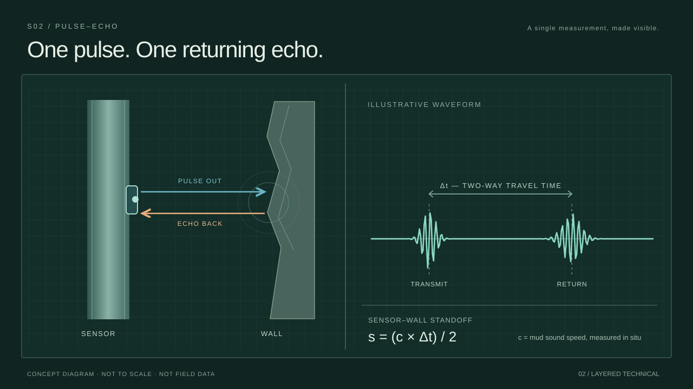
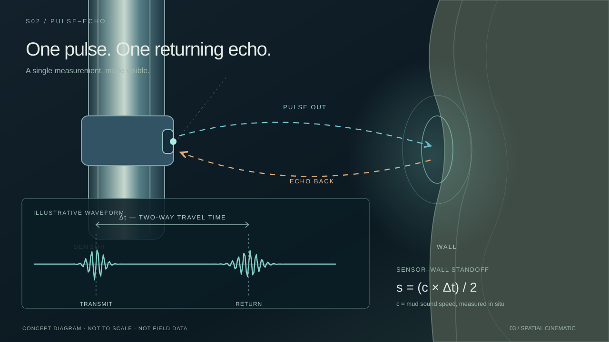
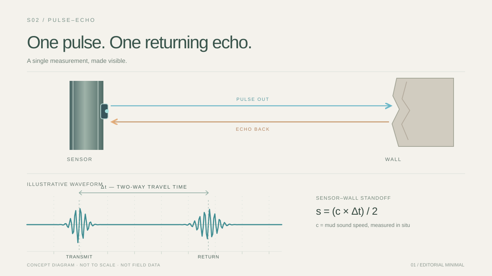

# S02 Technical Motion Graphics — Taste Test 01

**Date:** 14 October 2026  
**Type:** Three original SVG-first art-direction treatments plus a narrower minimal refinement, **not** client deliverables or technically approved content.  
**Scope:** ENP3 S02 V2 panel 3 *first waveform / time-of-flight principle*. Do not replace the live Padlet or storyboard panels with these studies without an explicit decision.

## The controlled comparison

All treatments show the same narrative and technical information:
- A **single schematic imaging sensor** emits a pulse toward a wall; the echo returns **to that same sensor**.
- A conceptual waveform depicts transmission and the later returning echo; **Δt is the two-way travel-time interval**.
- The symbolic relation **sensor-to-wall stand-off `s = (c × Δt) / 2`** is displayed, with **`c` the sound speed in drilling mud measured in situ**.
- The waveform, signal peaks and dimensions are **artistic, not real logs or calibrated values**. The diagram is **not to scale**; no specific ENP3 sensor count/placement or borehole dimensions are depicted in this simplified elevation.
- This is an **isolated principle demonstration**, not operational drilling/scanning. Later S02 panels must retain drill-string rotation and measured circumferential accumulation.

**Controls held constant:** exact headline, copy, technical labels, symbol meanings, event ordering, abstract waveform structure (same two impulses), missing numeric values, 1280×720 aspect ratio.

**Variables under taste test:** visual complexity, information density, layering, spatial anchoring, linework, dark/light treatment, camera/scene relationship. This comparison varies multiple art-direction variables at once; any favorite is a **contextual direction**, not evidence for all individual micro-choices.

## A — Editorial Minimal

**Hypothesis:** Quiet modern typography and a light, spacious diagram communicate the echo without competing graphics.

[Open editable SVG A](01_minimal_technical.svg)

- **Motion proposal:** gentle reveal of outward line, return, then waveform and elapsed-time bracket. Text can fade or subtly settle; motion never needs to dominate.
- **Benefit to test:** easiest reading and serene confidence.
- **Failure to watch:** so neutral it feels like a slide rather than part of a cinematic scene.

## B — Layered Technical

**Hypothesis:** Structured measurement-grid and instrument-style layers communicate an engineered scientific system while remaining legible.

[Open editable SVG B](02_layered_technical.svg)

- **Motion proposal:** one measured event lights up, a waveform records it and a single bracket/data statement settles. Technical layers stay subordinate to the reading path.
- **Benefit to test:** productive information density and technical character.
- **Failure to watch:** stylized instrument UI/HUD elements imply actual source software or calibrated measurement, despite this being entirely conceptual.

## C — Spatial Cinematic

**Hypothesis:** A cinematic, depth-rich schematic allows the event and graphical annotations to inhabit one visual environment, with the waveform still legible in screen space.

[Open editable SVG C](03_spatial_cinematic.svg)

- **Motion proposal:** camera approaches the schematic tool/wall relationship, signal pulse and returning echo reveal the distance; a waveform panel resolves as an authored on-screen graphic.
- **Benefit to test:** a visual explanation that shares the scene's depth and narrative.
- **Failure to watch:** dimensional illustration could be mistaken for accurate CAD/physics, or the moving camera could distract from the travel-time relationship.

## Selection record — first round

**E015 · 14 October 2026 — Director's exact selection:** “A — Editorial Minimal”.

This selects the **overall treatment** for the S02 first waveform / travel-time visualization. The director did not yet state whether negative space, typography, linework, color or absent 3D integration was the decisive factor. It does **not** reject the usefulness of B or C in other shots. No technical/client approval is implied.

## Focused refinement: How much measurement scaffolding?

The next test holds the original light palette, layout, wording, subject/return arrows, waveform, symbolic formula and technical content fixed, varying **only the presence of subtle guide marks around the waveform**. Unlike the first-round comparison, this does not simultaneously change background, type scale, framing and integration approach.

| Refined option | Graphic | Hypothesis |
|---|---|---|
| **A1 — Pure editorial** |  | Undistracted pulse/echo waveform reads as confidently technical without added guides |
| **A2 — Editorial with guides** |  | Subtle unlabeled vertical guides in the waveform zone improve the sense of measurement without becoming an instrument dashboard |

Open full-size: [A1 original](01_minimal_technical.svg) · [A2 with guides](04_editorial_minimal_with_guides.svg).

**Only isolated variable:** very restrained **uncalibrated vertical waveform guides/ticks** in A2. They are not time graduations, do not contain sample counts or values, and make no quantified claim.

**Feedback sought:** Prefer A1, A2, both equally, or neither? What specifically changes the sense of precision, elegance or readability? This does not decide a universal grid style.

## Original first-round review questions (record retained)

**Original prompt (answered):** Choose the most appealing visual treatment for this specific S02 moment: A, B, C, a combination (specify which qualities), or none. **Director selected A.** Add *why*: typography, linework, space, complexity, engineering clarity, integration, or something else. Also identify one detail that feels unnecessary or weak.

Do **not** treat an early choice as a universal rule. Repeat a tighter A/B comparison after the director names the particular attributes that matter.

## Agent handoff / next decision

1. **First-round selection E015 is recorded** in [Taste Evidence Register](../../02-TASTE_EVIDENCE_REGISTER.md), linked to this exact study.
2. The [Typography & Graphic Integration Module](../../08-TYPOGRAPHY_AND_GRAPHIC_INTEGRATION_v0.3.md) reflects the contextual A selection. The A1/A2 density refinement is **still awaiting director feedback**; never infer its result.
3. If one treatment becomes a real S02 contender, redesign with **verified Blender/CAD geometry and client technical feedback** under [Scene Direction Contract](../../07-SCENE_DIRECTION_CONTRACT_v0.2.md).
4. Final graphic motion curves and content still require a real playblast/review.

## Source references

- [S02 V2 narrative, panel 3](../../../02_Storyboard/V2/ECCO_Section_02_Reveal_The_Principle_Padlet_v2/PADLET_SECTION_02_V2.md)
- [Canonical ENP3 Engineering Baseline](../../../01_Foundation/02-ENGINEERING_BASELINE.md)
- [Current typography / graphic-integration taste](../../08-TYPOGRAPHY_AND_GRAPHIC_INTEGRATION_v0.3.md)
