# A03 — Visual shot index v002

15 October 2026 · 22 source-based shot preview images · For Radzi review

[Open browsable gallery](Previews/v002/gallery_v002.html) · [Shot register v002](../../shot-register_v002.md) · [Blockers v001](../../blocker-register_v001.md)

One PNG per proposed moving shot, with the storyboard states grouped as in the inventory and the inherited camera/transition and information notes preserved. These are conceptual static previews; no new shot design or product-accurate renders. Existing restricted ENP1 data is not included. Click any image for full size.

## S01-01

Establish rig and follow drill string from surface toward seabed.

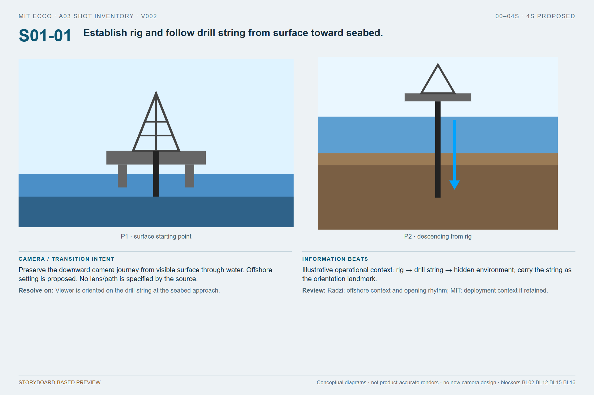

[Full-size PNG](../../../Shots/S01/S01-01/Previews/S01-01_inventory-preview_v002.png) · [Editable preview source](../../../Shots/S01/S01-01/Previews/S01-01_inventory-preview_v002.html)

## S01-02

Continue subsurface descent to ECCO in the existing annulus.

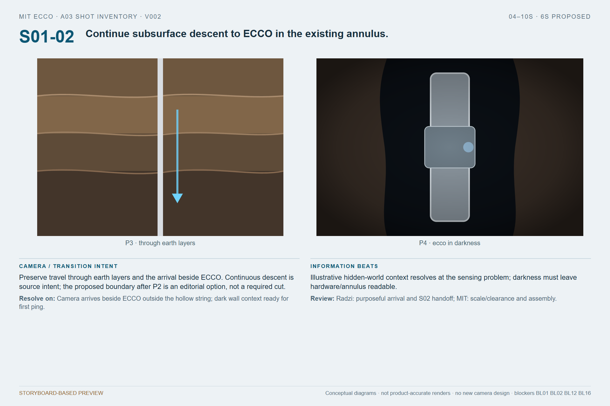

[Full-size PNG](../../../Shots/S01/S01-02/Previews/S01-02_inventory-preview_v002.png) · [Editable preview source](../../../Shots/S01/S01-02/Previews/S01-02_inventory-preview_v002.html)

## S02-01

First pulse reaches a local wall spot; echo returns to emitting sensor; repeat spots with string rotation.

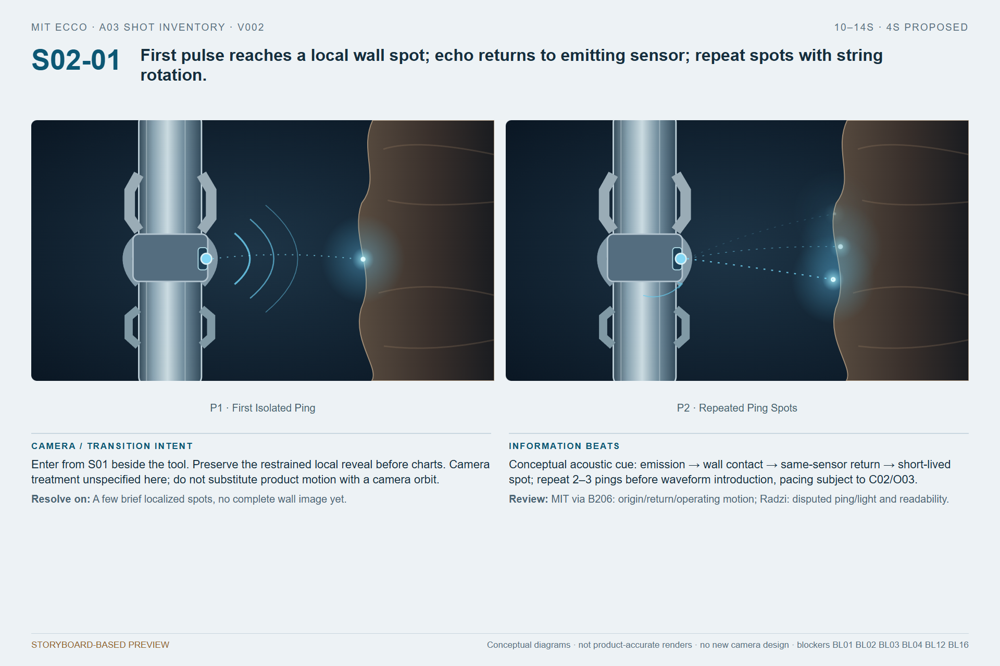

[Full-size PNG](../../../Shots/S02/S02-01/Previews/S02-01_inventory-preview_v002.png) · [Editable preview source](../../../Shots/S02/S02-01/Previews/S02-01_inventory-preview_v002.html)

## S02-02

Connect echo arrival to two-way travel time, then repeat 2–3 waveform readings.

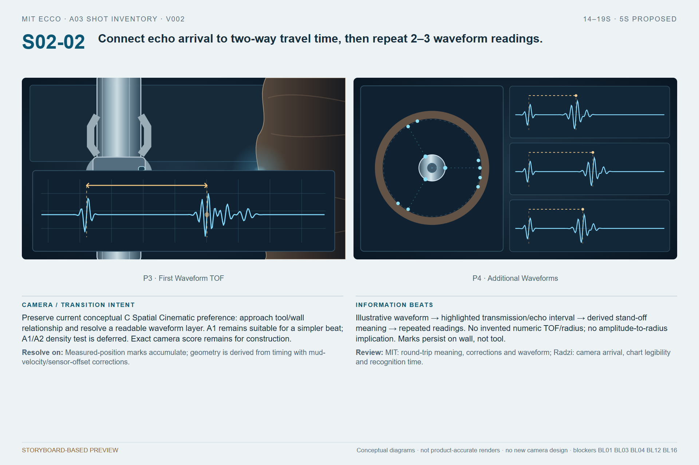

[Full-size PNG](../../../Shots/S02/S02-02/Previews/S02-02_inventory-preview_v002.png) · [Editable preview source](../../../Shots/S02/S02-02/Previews/S02-02_inventory-preview_v002.html)

## S02-03

Accumulated circumferential samples resolve as one measured 360° outline.

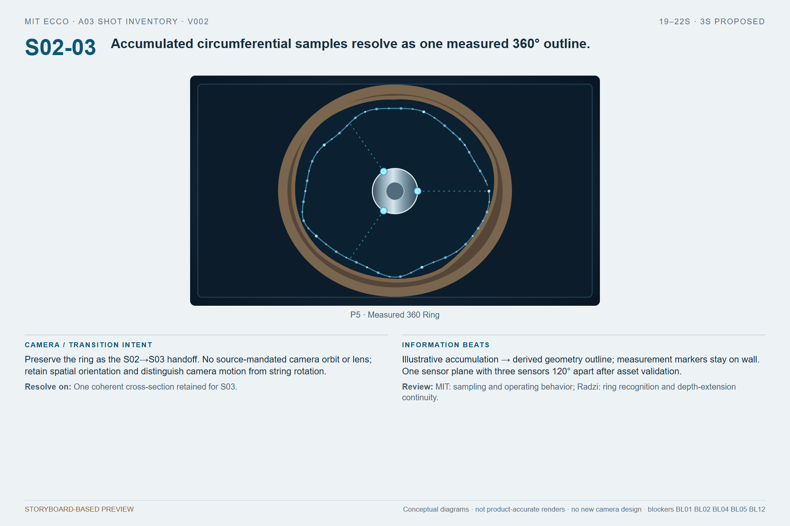

[Full-size PNG](../../../Shots/S02/S02-03/Previews/S02-03_inventory-preview_v002.png) · [Editable preview source](../../../Shots/S02/S02-03/Previews/S02-03_inventory-preview_v002.html)

## S03-01

Compare nominal bit-size reference with enlargement and tight regions.

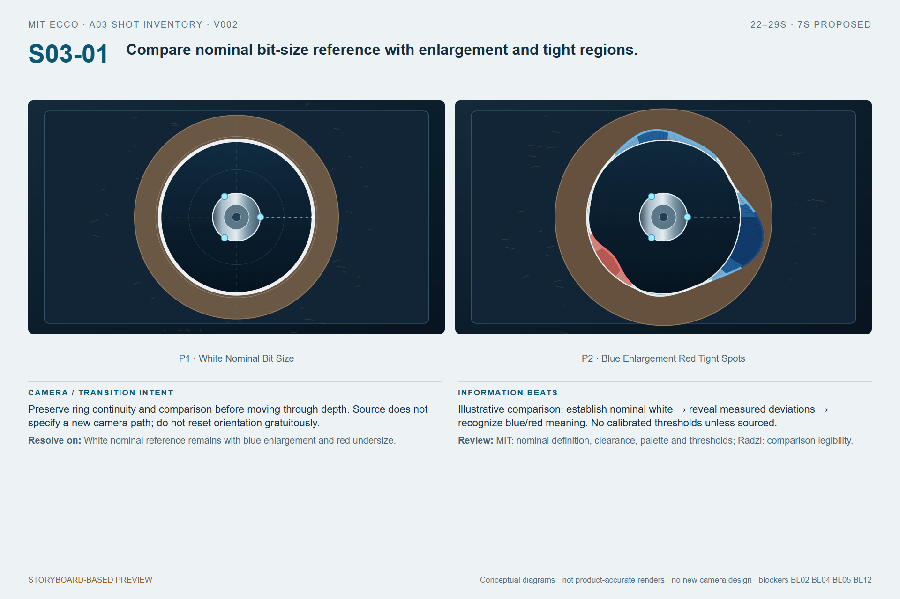

[Full-size PNG](../../../Shots/S03/S03-01/Previews/S03-01_inventory-preview_v002.png) · [Editable preview source](../../../Shots/S03/S03-01/Previews/S03-01_inventory-preview_v002.html)

## S03-02

Accumulate geometry through depth; spiral is wall deformation, not a ribbon inside the hole.

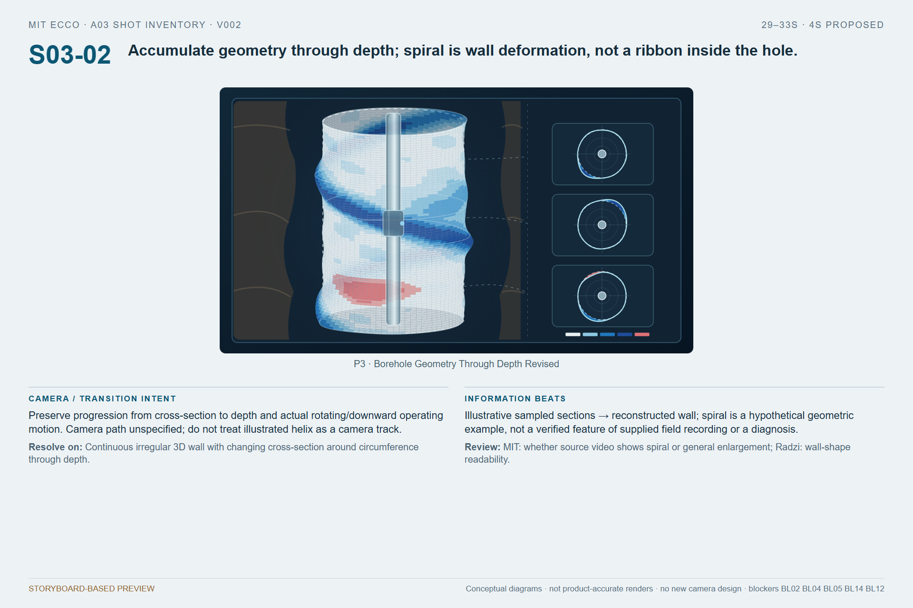

[Full-size PNG](../../../Shots/S03/S03-02/Previews/S03-02_inventory-preview_v002.png) · [Editable preview source](../../../Shots/S03/S03-02/Previews/S03-02_inventory-preview_v002.html)

## S03-03

Brief bridge: one echo carries timing and amplitude as separate properties.

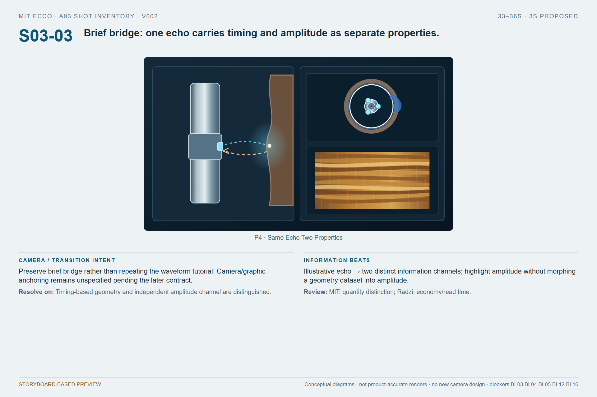

[Full-size PNG](../../../Shots/S03/S03-03/Previews/S03-03_inventory-preview_v002.png) · [Editable preview source](../../../Shots/S03/S03-03/Previews/S03-03_inventory-preview_v002.html)

## S03-04

Repeated amplitude readings build a separate warm formation image.

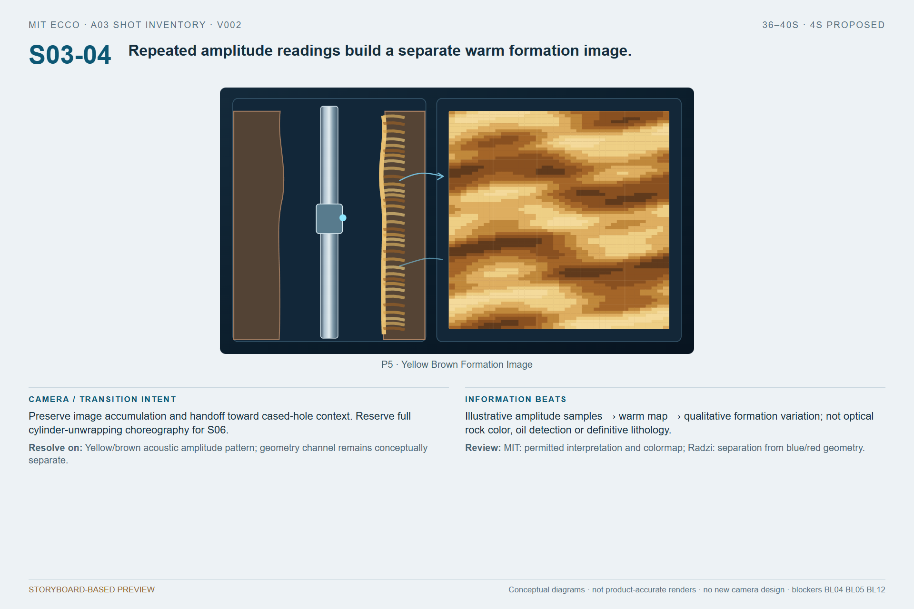

[Full-size PNG](../../../Shots/S03/S03-04/Previews/S03-04_inventory-preview_v002.png) · [Editable preview source](../../../Shots/S03/S03-04/Previews/S03-04_inventory-preview_v002.html)

## S04-01

Bit, BHA and ECCO retrieve upward into pre-existing upper casing.

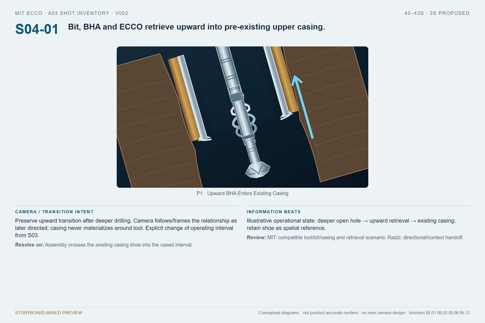

[Full-size PNG](../../../Shots/S04/S04-01/Previews/S04-01_inventory-preview_v002.png) · [Editable preview source](../../../Shots/S04/S04-01/Previews/S04-01_inventory-preview_v002.html)

## S04-02

Pulse interacts with inner steel; compare casing ringdown with supported/poorly supported annulus.

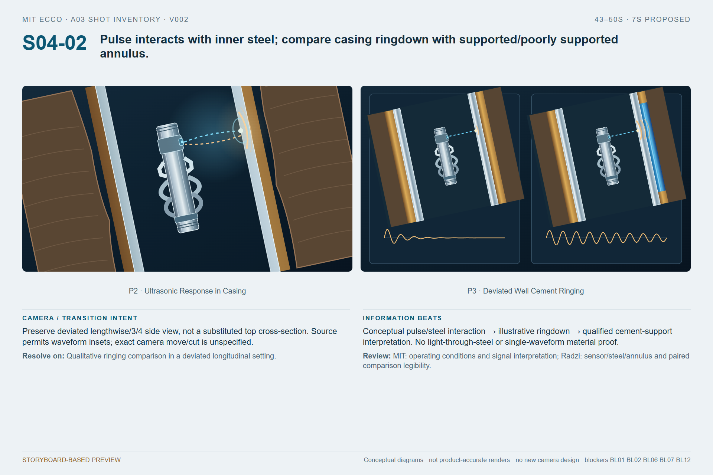

[Full-size PNG](../../../Shots/S04/S04-02/Previews/S04-02_inventory-preview_v002.png) · [Editable preview source](../../../Shots/S04/S04-02/Previews/S04-02_inventory-preview_v002.html)

## S04-03

Relate localized axial channel behind casing to a 360° cement interpretation map.

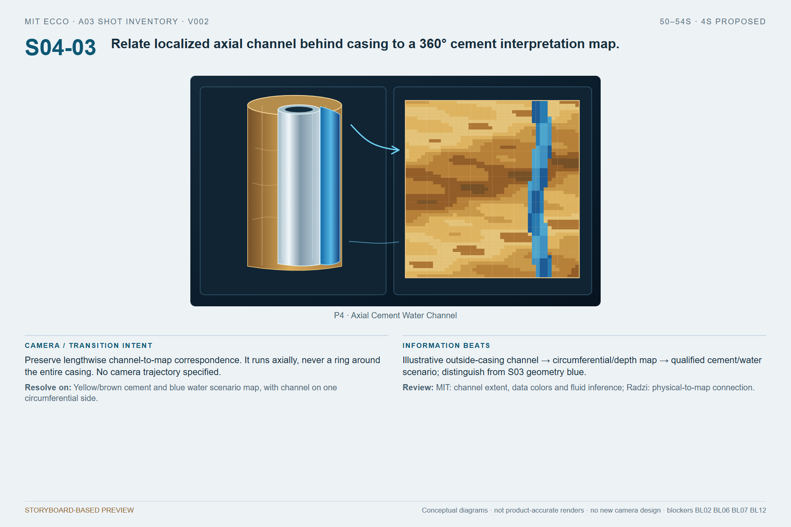

[Full-size PNG](../../../Shots/S04/S04-03/Previews/S04-03_inventory-preview_v002.png) · [Editable preview source](../../../Shots/S04/S04-03/Previews/S04-03_inventory-preview_v002.html)

## S04-04

Reveal inner-wall wear groove and locally increased ID with unchanged reference OD.

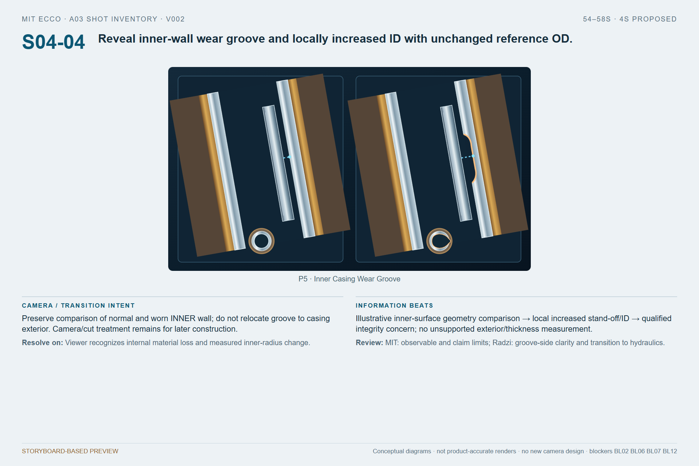

[Full-size PNG](../../../Shots/S04/S04-04/Previews/S04-04_inventory-preview_v002.png) · [Editable preview source](../../../Shots/S04/S04-04/Previews/S04-04_inventory-preview_v002.html)

## S05-01

Establish mud down string, out bit, upward annular return with cuttings.

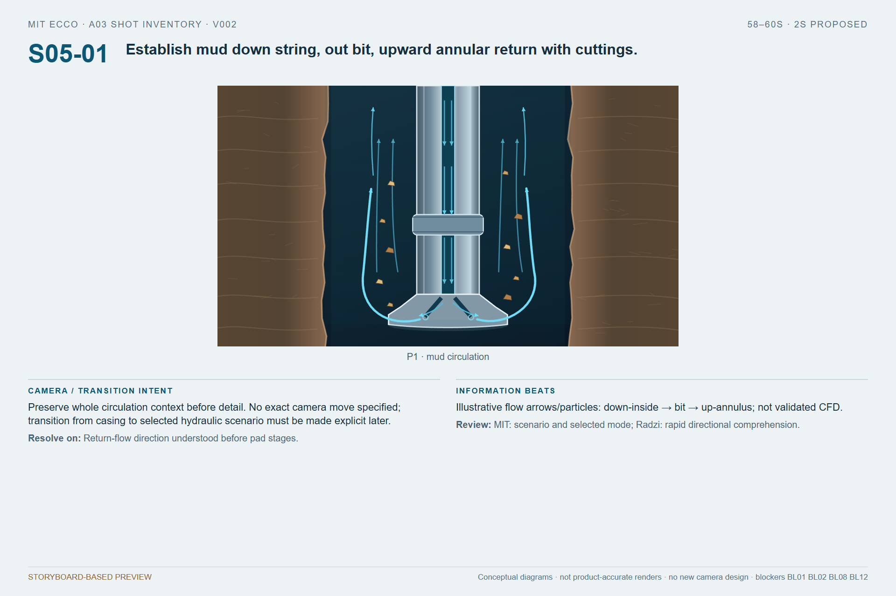

[Full-size PNG](../../../Shots/S05/S05-01/Previews/S05-01_inventory-preview_v002.png) · [Editable preview source](../../../Shots/S05/S05-01/Previews/S05-01_inventory-preview_v002.html)

## S05-02

Show accelerator → two twisted-pad sets → diffuser as integrated body functions.

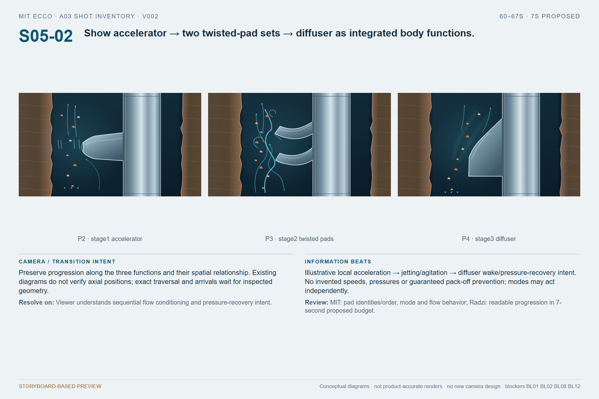

[Full-size PNG](../../../Shots/S05/S05-02/Previews/S05-02_inventory-preview_v002.png) · [Editable preview source](../../../Shots/S05/S05-02/Previews/S05-02_inventory-preview_v002.html)

## S05-03

Resolve integrated stages using MIT analysis if supplied and approved.

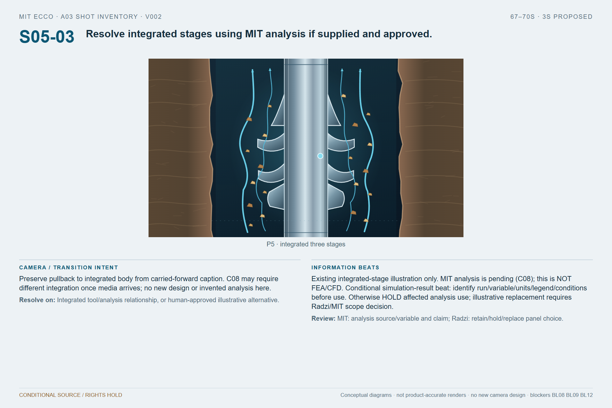

[Full-size PNG](../../../Shots/S05/S05-03/Previews/S05-03_inventory-preview_v002.png) · [Editable preview source](../../../Shots/S05/S05-03/Previews/S05-03_inventory-preview_v002.html)

## S06-01

Leave downhole hardware for reconstructed 3D measurements from memory.

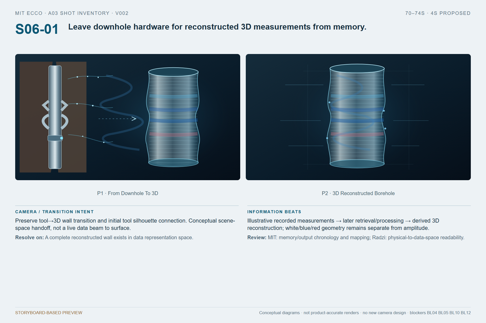

[Full-size PNG](../../../Shots/S06/S06-01/Previews/S06-01_inventory-preview_v002.png) · [Editable preview source](../../../Shots/S06/S06-01/Previews/S06-01_inventory-preview_v002.html)

## S06-02

Open reconstructed wall along axial seam and flatten to azimuth/depth maps.

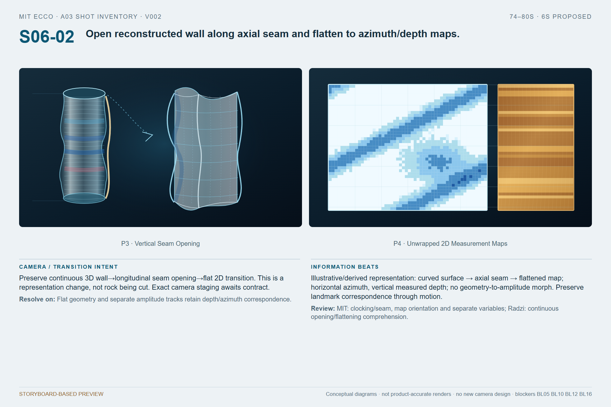

[Full-size PNG](../../../Shots/S06/S06-02/Previews/S06-02_inventory-preview_v002.png) · [Editable preview source](../../../Shots/S06/S06-02/Previews/S06-02_inventory-preview_v002.html)

## S06-03

Conditional single genuine Mi-VU log reveal with correct ENP1 identity.

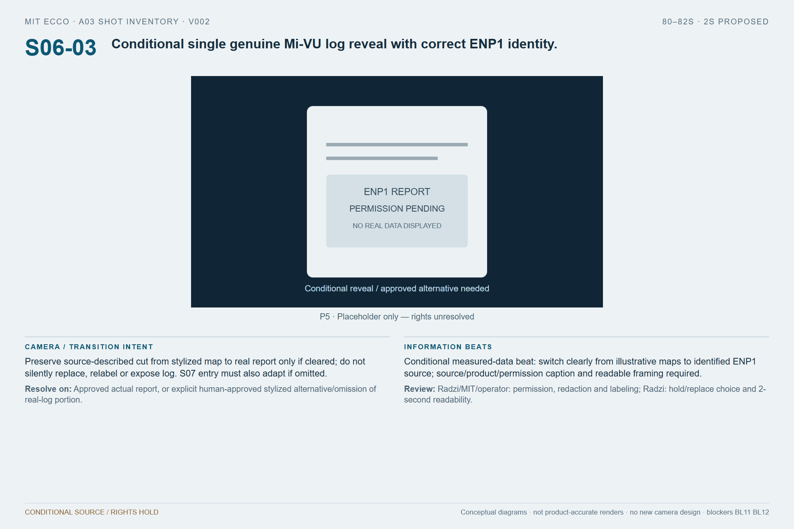

[Full-size PNG](../../../Shots/S06/S06-03/Previews/S06-03_inventory-preview_v002.png) · [Editable preview source](../../../Shots/S06/S06-03/Previews/S06-03_inventory-preview_v002.html)

## S07-01

Reconnect engineering output to the hardware responsible.

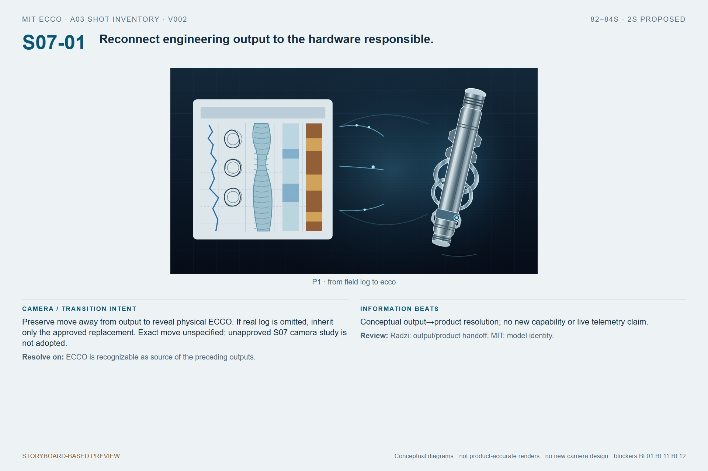

[Full-size PNG](../../../Shots/S07/S07-01/Previews/S07-01_inventory-preview_v002.png) · [Editable preview source](../../../Shots/S07/S07-01/Previews/S07-01_inventory-preview_v002.html)

## S07-02

Clean integrated product hero followed by recall of five established capabilities.

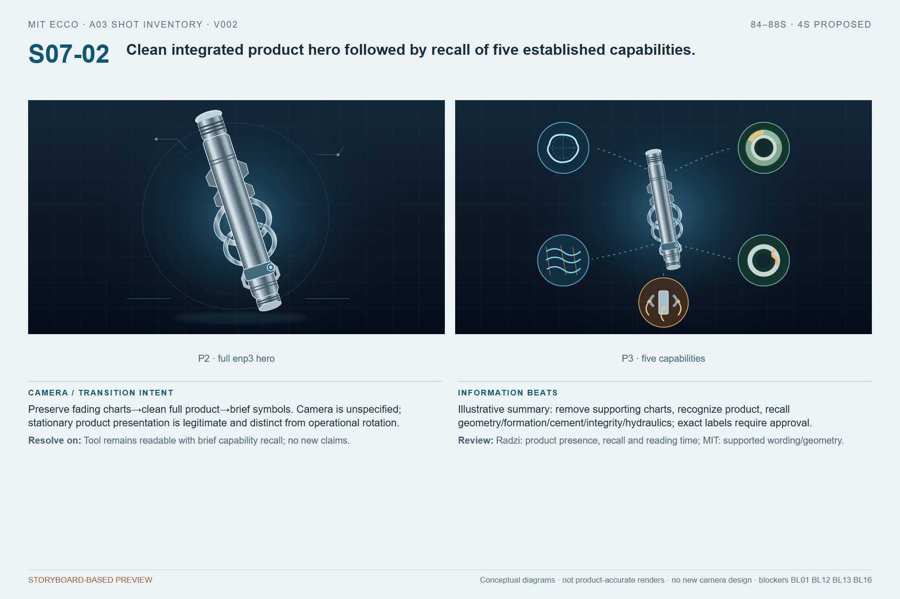

[Full-size PNG](../../../Shots/S07/S07-02/Previews/S07-02_inventory-preview_v002.png) · [Editable preview source](../../../Shots/S07/S07-02/Previews/S07-02_inventory-preview_v002.html)

## S07-03

Resolve with complete product and official MIT identity/tagline.

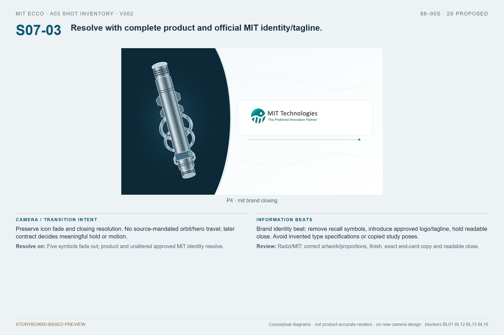

[Full-size PNG](../../../Shots/S07/S07-03/Previews/S07-03_inventory-preview_v002.png) · [Editable preview source](../../../Shots/S07/S07-03/Previews/S07-03_inventory-preview_v002.html)
