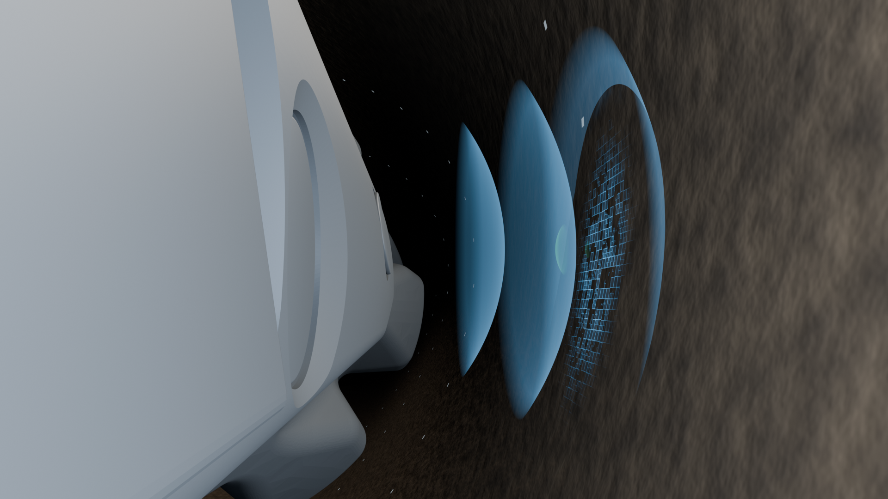

# T8 / B202-S — first scanning-history still for direction review

16 October 2026. Task `53fb67d1-e3cb-480e-a910-a544338a4470`; worker `codex-b202-stills-01a14455`; run `8a1255ae-ce8f-4dad-9edc-da68abb0179b`. Authority: Radzi's “Your task is B202”, current AGENTS.md and fresh Rolladice handoff. T8 owns stills/handover; T27 owns new animation. T7 prerequisite inspected live and accepted. Pinned roadmap v2 current. Base main: `87e2f85cb28125bfa4aabafdaa5032a4c91bbc50`.

**Status: incomplete, awaiting first-frame direction.** This is a bounded baseline review, not full-ticket completion or an approved handover. Nominal/enlarged/tight/spiral reconstruction and separate amplitude stills are not built. No criteria have been claimed complete.

## Current review

Retains the accepted T7 gap camera, tool, wall and contact state at inherited frame31. Adds 144 sparse illustrative sample locations along three phase-offset historical paths. v002 replaces v001's round beads with flat four-corner tiles projected onto the actual retained wall. White marks denote sample locations only; they are not the later radius colormap. Cyan remains the inherited active acoustic/contact illustration.

**Decision requested:** retain the wall-anchored sample-history treatment as the starting point for reconstruction, or revise its readability? [B2 workflow](../../../B2-VISUAL_APPROVAL.md) requires “current frame → concrete question → Radzi decision → bounded Blender change”. No T26 completion gate or inter-chat messaging. Radzi can relay the actual frame to the direction partner.

Internal visual critique: the authentic gap relationship and source event remain readable. Flat marks read more as a surface overlay than v001's bead-like particles. This tight frame demonstrates local acquisition, but cannot establish a whole circumferential reconstruction or motion by itself; a wider outcome view remains to be developed after feedback. Display density/size and treatment are unapproved. No visual acceptance or MIT engineering confirmation is inferred.

## Inputs and source preservation

- T7 native `Mechanisms/B201/Scenes/B201_pulse-echo_fast-preview_v005.blend`, SHA256 `b1f5cc6c892835517c0c0e77636d0e75f1adbff657eb342f24bd55714c1f7175`, and [handover](../T-007/handover_motion_v005.md).
- T5 plugged v002 SHA256 `704a91cb478a1a38304835786fa62d549df5bf5833e457cbc4da094fd6557fd7` and T6 well v003 SHA256 `6bdacfefa6b999d941d0e2a93a75b26563be8e46141ee761114fdb81dae754c4`.
- Engineering baseline; S02/S03 V2 narratives; C01/C03 color meaning; active Directorial Identity and Scene Director. [Single mechanism direction contract](../../../Mechanisms/B202/direction.md).

Official Blender MCP read-only queries confirmed the open saved Still03v013 scene before execution and again after checks; it remains clean and unchanged. All construction/rendering ran in isolated background Blender5.2.2 LTS. New B202 consumers retain source geometry and relative library, without master edits. No restricted ENP1 data is used.

## Exact artifacts and checks

Root: `C:/Users/RZ1/Desktop/RZ/261013-MIT-Ecco/04-Production/`.

- Current editable local scene: `Mechanisms/B202/Scenes/B202_sampling-history_still01_v002.blend`.
- Current 1920×1080 review image: `Mechanisms/B202/Previews/Still_01/B202_sampling-history_still01_v002.png`.
- [Exact output/source hashes and sample correspondence](Evidence/Still_01/build-render_v002.json); [fresh-open verification](Evidence/Still_01/verification_v002.json).
- [v001 builder](../../../Mechanisms/B202/Scripts/build_still01_v001.py), [v002 revision](../../../Mechanisms/B202/Scripts/build_still01_v002.py), [verifier](../../../Mechanisms/B202/Scripts/verify_still01_v002.py).
- [Consumer controls and reuse](../../../Mechanisms/B202/README.md); [technical review questions](review-questions_v001.md).

16 implementation checks pass. Exact product/wall geometry and transforms, camera and inherited action count match T7. T5/T6/T7 source hashes unchanged. Relative library resolves. All144 sample centers and576 tile corners project to the retained wall within0.24 micrometres numerical error; saved tile display offset is0.10mm inward within0.009 micrometres. These are numerical implementation checks, not sensor accuracy claims. Visibility/size controls and PNG dimensions/hash pass. Image visually inspected at full view. Reopened saved candidate before render; native v002 render3.671 seconds. No new animation actions or sample animation created.

The first visibility test needed an explicit object dependency update after scripted custom-property assignment; the verifier now tags the controller and reevaluates the frame. Candidate geometry/image unchanged by that test-harness correction. v001 scene/image/build log retained locally as useful rejected display-form evidence.

Reproduce from repository root with installed Blender: `blender.exe -b -t 6 --python 04-Production/Mechanisms/B202/Scripts/verify_still01_v002.py`. Builders refuse candidate overwrite. Paths use the installed `C:/Program Files/Blender Foundation/Blender 5.2/blender.exe`.

## Limits and next action

The helical history,0.65m axial span, one revolution and48 marks per path are authored display parameters, not actual data, firing schedule, resolution, RPM or physical pitch. Source-axis negative-X traversal is an illustration pending hardware datum/operational confirmation, not certified drilling direction. Three paths do not imply a specific assignment of the datasheet's108 azimuth bins to individual transducers. Corrected travel-time geometry and echo amplitude remain distinct. O04/O06 and B206/T12 technical review remain open; no unsupported calibrated legend or lithology conclusion.

Await Radzi's direction on this exact first frame, then develop bounded reconstruction/output stills with nominal/enlarged/tight/spiral examples and separate warm amplitude meaning. Preserve approved T7 and retained B202 variants. T27 remains unstarted and unreleased.

Permitted report/scripts/evidence and selected v002 image synchronize to authorized main; exact containing SHA and commit-pinned links are recorded in Rolladice after a fresh remote check. Blend binaries and intermediate v001 media stay local/ignored or unstaged; no remote media backup is implied. Unrelated files are preserved. Full T8 stays in progress with a waiting run, not Review/Done.
