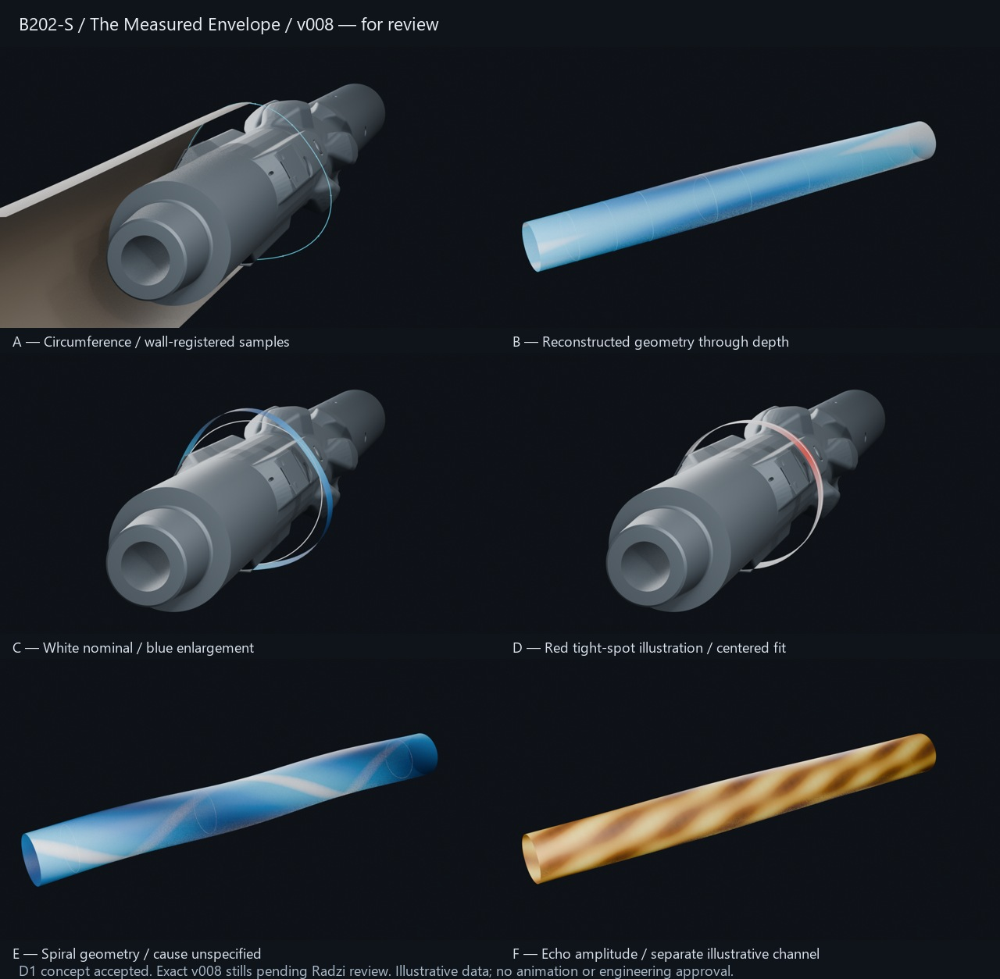

# T8 / B202-S — Measured Envelope still package v008

**Submitted for Radzi Review.** All requested agent still-development work is delivered: A circumference, B irregular reconstructed depth envelope, C nominal/enlarged comparison, D clearance-safe red tight illustration, E spiral example, F independent yellow/brown amplitude, plus editable master/consumers, controls, evidence and T27 handover. No animation, self-acceptance, final visual approval or MIT engineering certification is claimed.

16 October 2026. Task `53fb67d1-e3cb-480e-a910-a544338a4470`; worker `codex-b202s-01a144ac`; execution `ca53c52c-0b37-49d0-bccb-c0abb8112b15` (attempt3). Base `f05b985c84891cf1f974e6d77b4c03ec25b06133`; established `main` / `https://github.com/radz2291/Project-MIT-Ecco.git`. Full containing commit/link is attached in Rolladice after fresh remote verification. Native Blender files remain local/ignored, not uploaded/backed up by Git.

## What is agreed and what needs review

Radzi reviewed A/B/C v005 and accepted **The Measured Envelope at D1 concept level**, authorizing completion of B202-S. [Acceptance record with exact v005 hashes](Evidence/D1-acceptance_v005.json). Preserve registered circumference, depth envelope and white nominal comparison. Mechanism-development assets are the goal; T27/B202-M owns the complete scanning→circumference→depth→geometry-revelation progression, camera choreography and motion; B3 owns film integration. [Original v005 study report](report_study_v005.md) is history, not current status.

**Review now:** exact v008 stills, editable master and [T27 handover](handover_T27_v008.md). Newly developed tight/spiral/amplitude treatments and all exact v008 frames await Radzi's acceptance. B202-S goes to Review, never Done on the owner's behalf. T27 remains gated by the live T8 dependency/human acceptance; preparing a handover has not launched it.



## Exact deliverables

Local root: `C:/Users/RZ1/Desktop/RZ/261013-MIT-Ecco`.

| State | Exact final still candidate | Editable native scene |
|---|---|---|
| A — wall-registered circumference | [A v008](../../../Mechanisms/B202/Previews/Stills_v008/B202_A_v008.png) | [A source](../../../Mechanisms/B202/Scenes/B202_A_v008.blend) |
| B — reconstructed irregular envelope | [B v008](../../../Mechanisms/B202/Previews/Stills_v008/B202_B_v008.png) | [B source](../../../Mechanisms/B202/Scenes/B202_B_v008.blend) |
| C — white nominal / blue enlargement | [C v008](../../../Mechanisms/B202/Previews/Stills_v008/B202_C_v008.png) | [C source](../../../Mechanisms/B202/Scenes/B202_C_v008.blend) |
| D — red local tight-spot illustration | [D v008](../../../Mechanisms/B202/Previews/Stills_v008/B202_D_v008.png) | [D source](../../../Mechanisms/B202/Scenes/B202_D_v008.blend) |
| E — spiral through depth | [E v008](../../../Mechanisms/B202/Previews/Stills_v008/B202_E_v008.png) | [E source](../../../Mechanisms/B202/Scenes/B202_E_v008.blend) |
| F — independent echo-amplitude image | [F v008](../../../Mechanisms/B202/Previews/Stills_v008/B202_F_v008.png) | [F source](../../../Mechanisms/B202/Scenes/B202_F_v008.blend) |

[Reusable master v008](../../../Mechanisms/B202/Scenes/B202_measured-envelope_master_v008.blend), collection `B202_MEASURED_ENVELOPE_v008`; [configuration](../../../Mechanisms/B202/config_v008.json); [still presets](../../../Mechanisms/B202/presets_v008.json); [source geometry tables](../../../Mechanisms/B202/sampling_tables_v008.json); [wall lookup helper](../../../Mechanisms/B202/Scripts/sample_profile_v008.py); [single direction contract](../../../Mechanisms/B202/direction.md). All seven native scenes and six PNGs have exact SHA256/size entries in the [verification manifest](Evidence/verification_v008.json).

## Reuse and source integrity

Accepted T5 plugged v002 stays a relative linked source, with ten local presentation meshes preserving source topology/coordinates/transforms. Whole-tool move/spin parents hardware, plugs/covers and three sensor references together. No product rescaling or geometry modification. Source X metres, actual source length 2.400m, inherited sensor plane .730m/120° references; exact transducer faces/shoulder datum/calibration remain O04.

Accepted T6 v003 provides exact evaluated irregular and spiral surfaces: 5,088 retained vertices each match a fresh independent source opening. T6's authored 25.4mm outward profiles and spiral 1.8m pitch are illustrative, not field data. Tight is a separate authored local undersize; it does not modify T6. Accepted T7 Motion_v005 scene and video match their previous manifest hashes. This run used isolated background Blender 5.2.2 and did not mutate the user's running scene.

`B202_CONTROL` exposes whole-tool travel/rotation, profile selection, independent tool/physical-wall/envelope/amplitude/section/sample/reference visibility, axial reveal window, azimuth reveal and separate opacity controls. Information stays world-fixed when the tool moves. B suppresses hardware independently to make the reconstructed shape the hero without expanding geometry. C/D use a narrow registered band to separate the comparison from a sleeve. All materials, layers, cameras and geometry are editable. No keyframes, actions or persistent handlers added.

Geometry and amplitude have independent objects, scalar attributes and materials. Geometry reads signed radius deviation; amplitude reads an independent authored angular/depth pattern, not radius. White nominal, blue enlargement, red undersize and yellow/brown amplitude retain S03 V2 meanings without a calibrated numerical legend. Warm colors are not optical rock colors, field readings, lithology proof or oil detection.

## Verification and visual review

**332/332 saved-scene/control/clearance checks pass**, plus **4/4 source-correspondence/preservation checks** and **3/3 fresh-collection-append checks**. These are agent implementation self-checks, not independent MIT validation.

- [Saved-scene verification/hashes](Evidence/verification_v008.json): all six consumers and master reopen; relative source resolution; ten unchanged source meshes/transforms per consumer; presets/render paths; 1280×720 nonblank stills; all three registered profile surfaces; no keyed motion; full tool movement with fixed wall measurements; common 120° sensor plane; actual axial/azimuth reveal; profile toggles; separate driven opacities; independent amplitude fields/material inputs; tight clearance; lookup/seam checks; unchanged T5/T6 hashes.
- [Independent fresh T6/T7 comparison](Evidence/source-correspondence_v008.json): exact retained irregular/spiral vertex sets and byte-preserved T7 scene/video.
- [Append portability](Evidence/append-reuse_v008.json): named master collection appends into a clean scene; hardware/sensors follow the remapped local controller, object drivers remap correctly and product library resolves. No persistent test scene or animation created.
- All six exact v008 images and the review sheet were visually inspected. A's contour remains at the sensor plane; B/E/F fit within frame; C/D distinguish nominal and selected mapped regions; warm amplitude is separate. True-scale departures remain subtle; shading does not establish acquisition accuracy or motion readability.

Render times (seconds): A 2.315, B 0.665, C 1.243, D 1.186, E 0.718, F 0.646; [build settings/results](Evidence/build_v008.json). Cheap Eevee stills; no finishing render or moving proof in T8.

v006/v007 local iterations retained under existing mechanism/record folders. v007 testing exposed a nonfunctional cyclic-curve bevel trim; v008 uses an explicit closing segment and verifies actual partial/full geometry differences. Earlier failed checks are retained as local diagnostics, not passed evidence. Initial unwanted v001/v002 remain deleted per prior owner instruction. Accepted v005 sources/previews remain unchanged.

Reproduce from repository root (builder refuses to overwrite an existing master):

```powershell
& 'C:/Program Files/Blender Foundation/Blender 5.2/blender.exe' --background --python '04-Production/Mechanisms/B202/Scripts/build_assets_v008.py'
& 'C:/Program Files/Blender Foundation/Blender 5.2/blender.exe' --background --python '04-Production/Mechanisms/B202/Scripts/verify_assets_v008.py'
& 'C:/Program Files/Blender Foundation/Blender 5.2/blender.exe' --background --python '04-Production/Mechanisms/B202/Scripts/verify_sources_v008.py'
& 'C:/Program Files/Blender Foundation/Blender 5.2/blender.exe' --background --python '04-Production/Mechanisms/B202/Scripts/verify_append_v008.py'
```

## Material limits / technical questions

Tight nominal radius 155.575mm, authored maximum inward departure 1.2mm, analytic minimum 154.375mm; full tool radial envelope 152.400077mm gives **1.974923mm conservative radial clearance**. Sampled minimum 154.378469mm; polygon interpolation checked at 108 illustrative azimuths preserves >1.5mm clearance. This is a straight centered geometric bound, not loaded/eccentric/dogleg fit or operational safety. A 12.25in nominal gauge bit would not pass this undersize; no bit is shown in this separate case. No restriction cause or drilling-through assertion.

No acquisition cadence, calibrated resolution/accuracy, acoustic simulation, actual field log or MIT-specific spiral diagnosis is asserted. T6 mesh spacing and sparse sample markers are display authoring, not instrument resolution. Lookup helper interpolates the sampled envelope and is not a ray/eccentricity/mud correction solver. Global reveal controls are presentation primitives, not a complete acquisition-history scheduler; T27 develops that temporal logic. Hardware end direction, sensor calibration and content-specific O04/O05/O14 remain for targeted technical review. No restricted ENP1 content used.

[B206/T12 questions](review-questions_v008.md) cover calibration, tight/bit scenario, spiral interpretation and amplitude meaning. No MIT feedback was received or fabricated; Radzi facilitates it through T12. These do not reopen the authorized baseline or block submission of this clearly limited still-development package.

## Closure and next action

All retained work is under `04-Production`; no deliverable is solely in scratch/temp/chat. Asset manifest updated. Current permitted PNGs/review sheet, builder/helper/check scripts, JSON controls/tables/evidence, direction, report and handover are selected for scoped synchronization. Native scenes, older iteration media/logs stay organized locally/ignored and are not remotely backed up. Unrelated work preserved. Source replacement requires rebuilding presentation copies and rechecking; relinking the hidden original alone is insufficient.

Radzi reviews/accepts exact v008 still package. Then a fresh T27 agent may consume the accepted master/handover under its live dependency and explicit authority, begin a cheap motion study and develop the complete mechanism progression. B202-S is submitted for Review, not marked Done.
