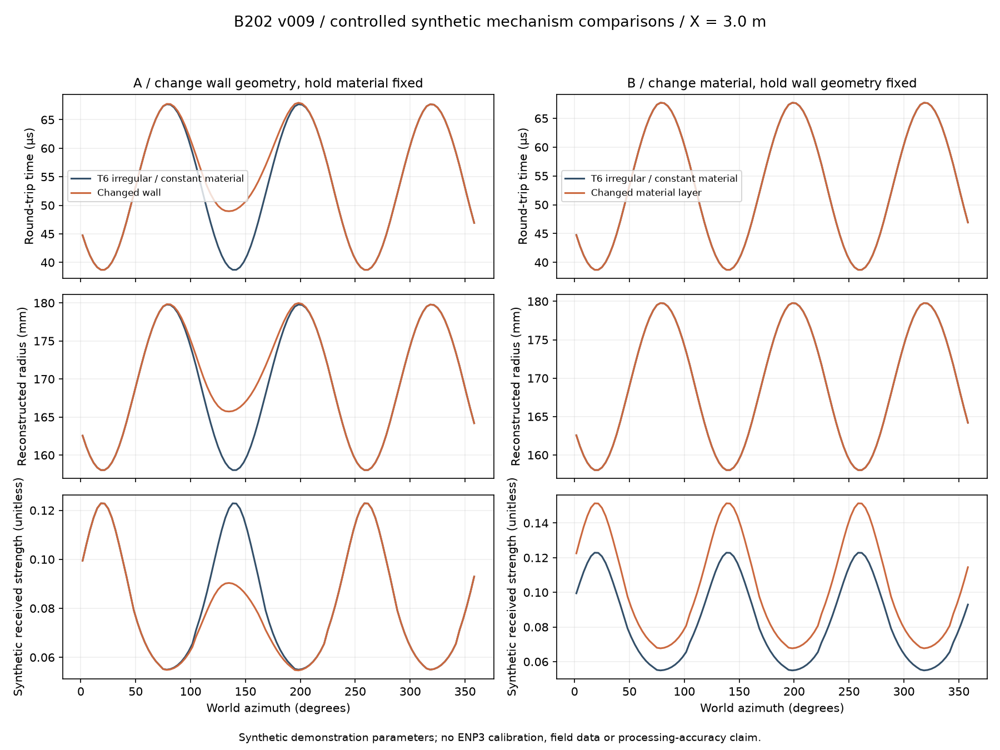

# T8 / B202-S — v009 technical-mechanism addendum

**Revised package submitted for final task acceptance by Radzi.** v009 replaces visual-only mapping with deterministic synthetic triangle-ray acquisition → round-trip travel time/received echo strength → measurement-only inverse → traceable radius/amplitude grids → editable reconstructed mesh. v008 and accepted T5/T6/T7 are preserved. **No self-Done, calibrated ENP3 accuracy, proprietary-processing claim, reliable formation classification or final engineering/visual approval.** Cinematic animation and specification test10/playable proof remain T27.

Authority: Radzi approved the bounded v009 plan and specifically required reconstruction/material integrity and scope separation.16 October2026. Task `53fb67d1-e3cb-480e-a910-a544338a4470`; worker `codex-b202s-01a144ac`; current run `804ac61f-63d6-4940-a040-beb31914a2c4`. Initial v009 run `5eead74b-c0aa-45a9-9715-3f2a140899ab` lease expired during the extended verification interval; same worker reclaimed before further Work mutations. Base `54c13b65c4f8042900615b9c021d3c0a72c1f0f5`, authorized `main`, origin `https://github.com/radz2291/Project-MIT-Ecco.git`. Exact containing commit/pinned links are recorded in Rolladice after verified push.

## Main result

| Controlled change | Travel time | Reconstructed radius / geometry | Received strength |
|---|---|---|---|
| Change a sector of T6-derived physical wall; material constant | Changes, maximum10.600µs | Changes, maximum7.950mm | Can change through stand-off/incidence |
| Change material layer; identical physical wall | Identical | Identical | Changes, maximum0.028965 unitless |

These are synthetic controlled-case results, **not manufacturer performance measurements**. The inverse receives no wall mesh or true hit coordinates; truth is stored separately for verification. **101/101 mechanism checks and165/165 consumer/reuse checks pass.** Same-model consistency is not independent acoustic validation. Prior v008's339 integrity checks are preserved history and are not relabeled sonic validation.



Review the exact [geometry-change identical-camera board](../../../Mechanisms/B202/Previews/Mechanism_v009/B202_geometry_comparison_v009.jpg), [material-change identical-camera board](../../../Mechanisms/B202/Previews/Mechanism_v009/B202_material_comparison_v009.jpg), [response/spiral/tight/sparse states](../../../Mechanisms/B202/Previews/Mechanism_v009/B202_mechanism_states_v009.jpg) and [numerical trace CSV with event IDs](Evidence/v009/comparison_trace_depth3m_v009.csv). All ten exact source renders, three boards and numeric figure were visually inspected. Source-scale geometry/material differences can be subtle in the wide frames; plots and traces expose the actual changes without exaggerating geometry or independently normalizing each image.

## Exact package and reusable source

Local root `C:/Users/RZ1/Desktop/RZ/261013-MIT-Ecco`.

- [Model/parameters/assumptions](../../../Mechanisms/B202/B202_acquisition_model_v009.md), [configuration](../../../Mechanisms/B202/acquisition_config_v009.json), [case/sensor/source index](../../../Mechanisms/B202/Data/v009/index_v009.json).
- [Editable master v009](../../../Mechanisms/B202/Scenes/B202_measured-envelope_master_v009.blend), collection `B202_MEASURED_ENVELOPE_v009`. Ten static comparison consumers and exact PNG/native hashes are in [consumer manifest](Evidence/v009/consumer_manifest_v009.json) and [consumer verification](Evidence/v009/verification_consumer_v009.json). Eleven native Blender files remain local/ignored, not uploaded/backed up by Git.
- `Mechanisms/B202/Data/v009/` contains eleven cases' deterministic gzip-JSON events, separate ground-truth intersections and reconstructed grids, plus an explicitly masked interpolation fixture.42,510 events cover complete, sparse, missed and weak-return cases. Full records remain machine-readable and are referenced by the index; [plain example bin trace](Evidence/v009/example_bin_trace_v009.json) exposes event-to-result lineage directly.
- [Producer](../../../Mechanisms/B202/Scripts/build_acquisition_v009.py), [pure measurement inverse/grid/response core](../../../Mechanisms/B202/Scripts/acquisition_core_v009.py), [consumer builder](../../../Mechanisms/B202/Scripts/build_consumer_v009.py), [replay adapter](../../../Mechanisms/B202/Scripts/replay_interface_v009.py).
- [Updated T27 handover](T27_mechanism_handover_v009.md), [targeted review questions](review-questions_v009.md), [single direction contract](../../../Mechanisms/B202/direction.md). [v008 still report](report_stills_v008.md) and [v008 handover](handover_T27_v008.md) remain preserved history.

## Physical and information relationships

Actual evaluated T6 triangles are the acquisition ground truth; actual inherited T5 sensor proxies follow full-tool fixture transforms, with120° phases and a common plane. Triangle first hits supply synthetic stand-off, round-trip time, incidence and explicit impedance/interface response. Blender BVH float seam misses are checked by float64 triangle intersection; no radius shortcut manufactures a return. No-hit or below-threshold echoes remain invalid. Initial numerical-seam diagnostics are retained locally and excluded from accepted results.

Reconstruction uses only saved sensor origin/direction, time, sound speed and validity; known world axis/pose is supplied for the eccentric test, never inferred as proprietary compensation. Grid nodes preserve source events/weights, depth/azimuth, quantity/channel validity, measured/interpolated flags and availability timestamps. Mesh coordinates are generated from reconstructed radii rather than copied source vertices. Missing sectors remain absent. Optional isolated-bin fill is explicitly interpolation and hidden by default; continuous face interiors/colors interpolate acquired corner-node values and are not extra measured pixels.

Amplitude is now received synthetic echo strength from explicit constant/layered impedances, a flat/inclined interface and a weak patch, with incidence, attenuation and range factors. The previous decorative sine input is suppressed. Geometry and amplitude have separate named fields/materials/controls on shared reconstructed coordinates. Changing geometry can affect received strength through path/incidence, even with fixed material. Yellow/brown is not optical rock color, actual field data or reliable lithology/oil classification.

The new consumer retains v008 hardware/look but suppresses old visual-only information collections. Controls provide case selection, independent geometry/amplitude, event-point display, evidence cutoff, interpolation opt-in, whole-tool pose/eccentric offsets and opacity. Cached full-bin means reveal only after all contributors exist; the raw replay helper can rebuild partial means from records up to any time. There are no scene keyframes or cinematic actions. T27 must retime/unwrap fixture poses and demonstrate the complete progression.

## Verification and acceptance boundary

[Mechanism acceptance evidence](Evidence/v009/verification_acquisition_v009.json):101 checks cover nominal cylinder/triangle/analytic reference, geometry-only and material-only changes, known eccentric pose with fixed axis, sparse/missed/weak acquisition, same-emitter reception/three phases, clearance, lineage/interpolation, deterministic fresh acquisition and unchanged source hashes. [Consumer evidence](Evidence/v009/verification_consumer_v009.json):165 checks cover derived positions/scalars, distinct colormap inputs, evidence-based masks/replay, emitter-pose correspondence, eleven saved natives, ten exact images, relative libraries and clean-scene append reuse.

Tests1–9 are implemented within synthetic limits. **Test10 is explicitly deferred to T27 by owner instruction and is not passed here.** Stills/replay primitives do not establish playable timing, camera or event continuity.

Numerical tolerances are model/tessellation checks, not ENP3 accuracy:2µm inverse-hit consistency,0.1mm nominal96-sector cylinder versus analytic radius,0.15mm grid-center versus independent source-triangle ray. They do not establish resolution/accuracy between acquired depth stations. Detailed per-case errors are in the evidence.

Tight source preserves the v008 hypothetical inward restriction. Including triangle faceting gives conservative centered full-tool clearance1.8923mm, acquired minimum1.9098mm, rather than reusing the continuous-radius1.9749mm bound. The nominal12.25in bit cannot pass. No bit/loaded/eccentric/dogleg operating-safety or restriction-cause claim. T6 spiral remains an authored example with no diagnosed cause.

Unknown acoustic-face/datum, actual mud calibration, waveform/strength estimator, normalization/gain, scheduling and proprietary eccentricity processing remain explicit MIT review items. All acoustic/material/schedule parameters are declared synthetic; no confidential ENP1 image, velocity constant or actual log is used as ENP3 input. The supplied specification is retained locally in `Records/Tasks/T-008/Private/`, excluded from public synchronization because it quotes confidential example metadata.

## Reproduction, preservation and closure

Run isolated background Blender from repository root, in order (builders refuse overwriting candidate data/master):

```powershell
& 'C:/Program Files/Blender Foundation/Blender 5.2/blender.exe' --background --python '04-Production/Mechanisms/B202/Scripts/build_acquisition_v009.py'
& 'C:/Program Files/Blender Foundation/Blender 5.2/blender.exe' --background --python '04-Production/Mechanisms/B202/Scripts/verify_acquisition_v009.py'
& 'C:/Program Files/Blender Foundation/Blender 5.2/blender.exe' --background --python '04-Production/Mechanisms/B202/Scripts/build_consumer_v009.py'
& 'C:/Program Files/Blender Foundation/Blender 5.2/blender.exe' --background --python '04-Production/Mechanisms/B202/Scripts/verify_consumer_v009.py'
```

`package_evidence_v009.py` creates labeled boards/CSV/plots from saved fields/renders using Pillow/Matplotlib; optional local plotting dependencies are under ignored Scratch, while the final artifacts and reusable scripts are in production folders. No deliverable exists solely in scratch/temp/chat. All v008/T5/T6/T7 hashes in the [preservation snapshot](Evidence/v009/preservation_before_v009.json) remain unchanged. The user-running Blender scene was not mutated.

Scoped scripts/configuration/data/evidence/reports and selected permitted comparison images are committed/pushed; exact remote candidate verification and pinned references are attached in Work. Native Blender files and initial diagnostics remain organized locally, not backed up by Git. Unrelated changes preserved. Radzi accepts the revised T8 package; fresh T27 then consumes it under its live dependency and authority. No T27 execution or self-acceptance.
