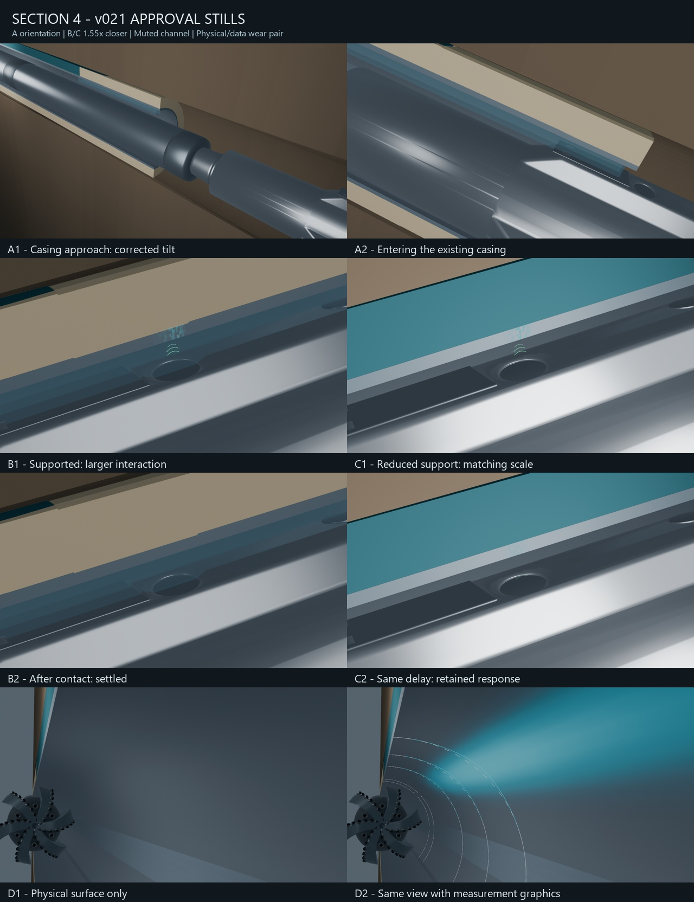

# Section 4 v021 — approval stills only

This is a bounded still review. **The v020 movie and its continuous camera animation remain unchanged.** These proposed camera poses and look adjustments have not been integrated into a new animation.

|ID|Full-resolution still|Review point|
|---|---|---|
|A1|[Casing approach](Previews/S04_A1_v021.png)|Casing runs toward the upper left; tool approaches from lower right.|
|A2|[Casing entry](Previews/S04_A2_v021.png)|Second moment with the mouth still visible as the tool enters.|
|B1|[Supported interaction](Previews/S04_B1_v021.png)|65 mm close view: about 1.55× the previous on-screen scale.|
|C1|[Reduced-support interaction](Previews/S04_C1_v021.png)|Same framing scale; fluid color is quieter and less saturated.|
|B2|[Supported after contact](Previews/S04_B2_v021.png)|Settled response at the selected delay.|
|C2|[Reduced support at the same delay](Previews/S04_C2_v021.png)|Remaining source response/return at exactly the same elapsed time.|
|D1|[Physical wear only](Previews/S04_D1_v021.png)|Reframed, with the bit toward the edge and no measurement graphics.|
|D2|[Wear and its data overlay](Previews/S04_D2_v021.png)|Same camera/light as D1, adding the existing profiles and computed depth.|

**Scenes/S04_approval-stills_v021.blend** opens on B1. It contains named static approval cameras and retains the original source camera action. It is a still-review workspace, not a new movie path. The rendered stills are the per-state appearance reference; the accompanying script applies each state's frame, camera, light and data-display settings reproducibly.

Physical well geometry, fixed half-section, calculated loss values and original event timing are preserved. The D wear remains shallow at its authored depth; the physical-only view is intentionally supplied so its readability can be judged separately from the overlay. No geometric exaggeration or artificial wear texture is added.

See **Records/verification.json**, **stills.json** and **review-report.md**. Previous versions remain intact. Heavy Blender files remain local.
